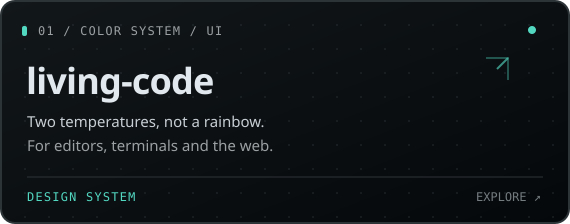
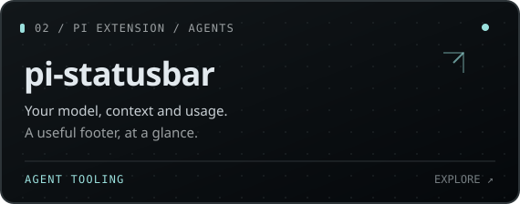
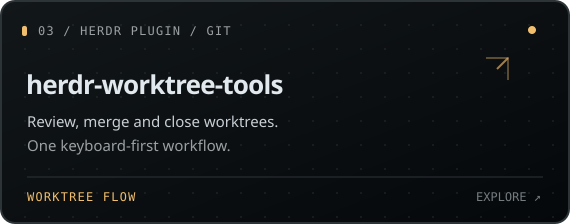
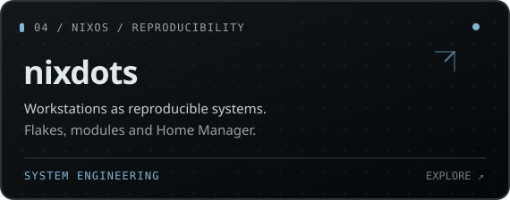
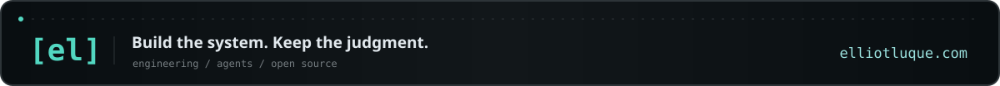

  

  <a href="https://elliotluque.com">Portfolio</a> &nbsp;·&nbsp;
  <a href="https://github.com/ElliotLuque/living-code">Living Code</a> &nbsp;·&nbsp;
  <a href="https://www.linkedin.com/in/elliot-luque-pascual/">LinkedIn</a> &nbsp;·&nbsp;
  <a href="mailto:contact@elliotluque.com">Email</a>

 

### `01 /` What I build

I'm a software engineer interested in the space where **software architecture, Linux systems and AI agents** meet.

I design the architecture, prepare the context and use agents to explore and implement within clear boundaries. **The goal isn't to generate more code. It's to build software we can understand, verify and evolve.**

### `02 /` Selected work

  
  
   
  
  

### `03 /` How I work

| **DESIGN** `→` | **ORCHESTRATE** `→` | **VERIFY** `✓` |
| :--- | :--- | :--- |
| Define architecture, interfaces and constraints before implementation. | Let agents explore and execute bounded tasks; keep decisions explicit. | Review diffs, test behavior and make changes maintainable. |

### `04 /` At my desk

`Java` · `Spring Boot` · `TypeScript` · `NixOS` · `Home Manager` · `Hyprland` · `Neovim` · `Git worktrees` · `Pi`

Currently exploring **Veyl**, a keyboard-first desktop shell built with Quickshell, and better workflows for running and reviewing coding agents.

  

Visual identity: <a href="https://github.com/ElliotLuque/living-code">Living Code Night</a> · Self-contained SVG animation · No external stats widgets
